<p align="center">
  
</p>

<h1 align="center">TradingNote</h1>

<p align="center"><strong>See your trades clearly. Build experience. Test your ideas.</strong></p>
<p align="center">An AI-powered trading journal and review companion for individual investors.</p>

<p align="center"><strong>English</strong> · <a href="README.zh-CN.md">简体中文</a></p>

---

## 🌐 Try the deployed app

**Official website:** [http://47.111.85.251/website/](http://47.111.85.251/website/) · **Public app:** [http://47.111.85.251/](http://47.111.85.251/) · **Application version:** [v2.0](https://github.com/Zia-Zeng/TradingNote/releases/tag/v2.0)

The public app runs on an Alibaba Cloud server. Its frontend and `/api` requests share one origin through Nginx; FastAPI stores trades, notes, and conversations in a SQLite file on that server. This is **not** an Alibaba Cloud RDS instance. There is currently no sign-in or per-user isolation: visitors share the same records, so please use demonstration data only. The screenshots below illustrate the product; live results depend on available market and AI services.

## 🎯 About the project

Trades leave a profit or loss, but the thinking behind them is easy to forget. TradingNote brings your trades, portfolio, notes, and available market context together so you can revisit **what you decided, what happened next, and which patterns deserve attention**.

The experience follows a simple loop: **record → review → understand → test → learn**. You make the decisions; TradingNote helps you see them more clearly.

This repository contains the source for the deployed, mobile-first application. AI, Feed, and backtesting features use the deployed API and the relevant data services.

## ✨ What you can do

| Area | What it helps you do |
| --- | --- |
| **Today** | Preview portfolio performance, browse the trading calendar, record trades and notes, review all trade notes, and read an AI daily summary. |
| **Agent · Review Trades** | Revisit a recorded trade with its transaction timeline and available market context. |
| **Agent · Insights** | Ask questions about your records and examine your trading style, habits, and supporting evidence. |
| **Agent · Backtest** | Run historical simulations for A-share or US symbols using SMA, RSI, MACD, Bollinger Bands, or volume strategies; inspect returns, drawdown, and completed-trade win rate. |
| **Tracking** | View open positions and their P&L, inspect each asset's price chart, trade timeline, and notes, and review results and decision-making with AI. |
| **Feed** | Read short pieces that connect market topics with investing books, encouraging learning and a calmer perspective. |

For a quick evaluation, open **Today** to see the portfolio, calendar, and daily summary; use **Agent → Review Trades** to inspect a recorded trade and save its suggestions as one note; then open **Tracking** for the asset timeline and AI analysis. Agent backtests and Feed depend on their configured external services.

## 📱 Product tour

### Today · Keep the day in view

Portfolio overview, trading calendar, trade recording, and a daily AI summary live in one place. The detailed summary connects market moves with the recorded portfolio. Open **All Trades** to browse recorded transactions and their attached notes.

<table>
  <tr>
    <td align="center" width="33%">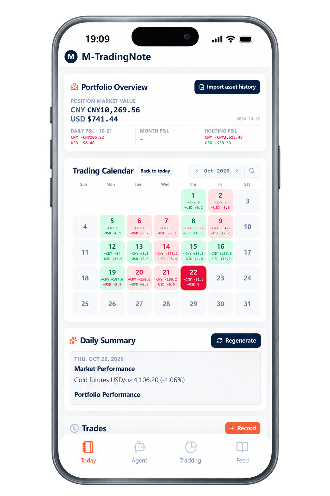</td>
    <td align="center" width="33%">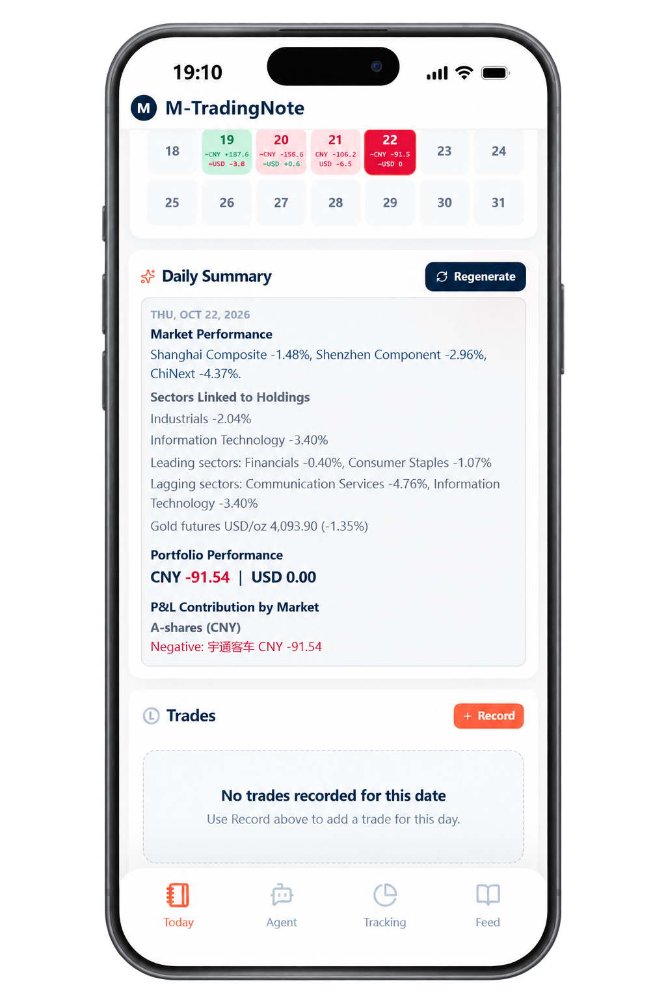</td>
    <td align="center" width="33%">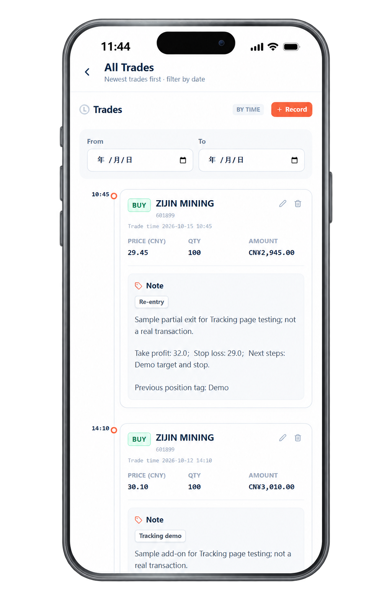</td>
  </tr>
</table>

### Agent · Understand and test

Ask the AI coach to review a trade in context, explore your broader trading habits, then compare a strategy idea with historical data through a backtest.

<table>
  <tr>
    <td align="center" width="33%">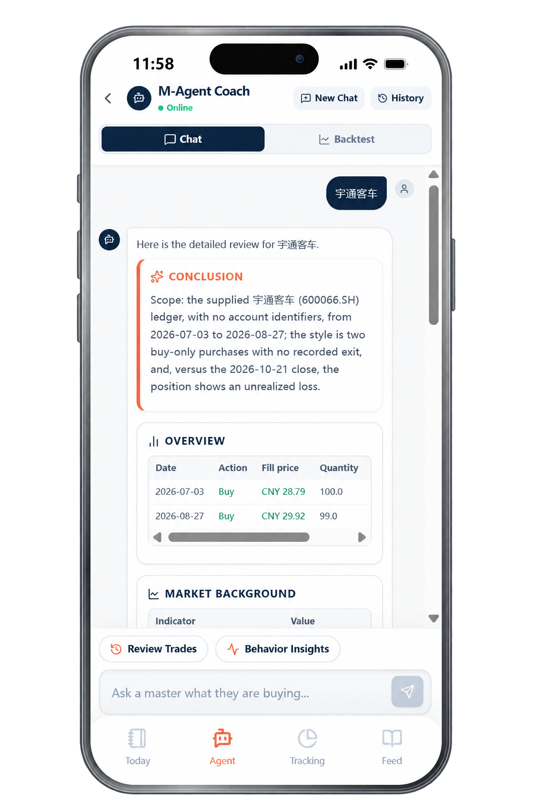</td>
    <td align="center" width="33%">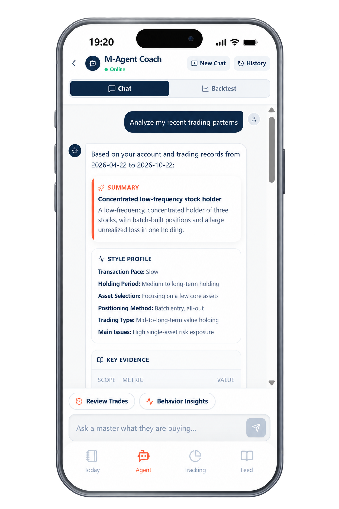</td>
    <td align="center" width="33%">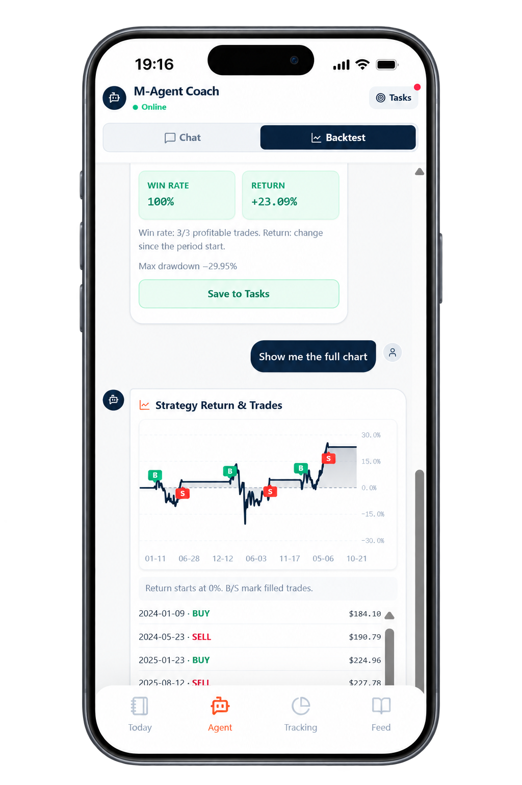</td>
  </tr>
</table>

### Tracking · Follow each position

Start with an overview of open positions, then open an asset to see its price history alongside recorded trades and notes. AI Tracking helps review the outcome, the decision process, and lessons for next time.

<table>
  <tr>
    <td align="center" width="33%">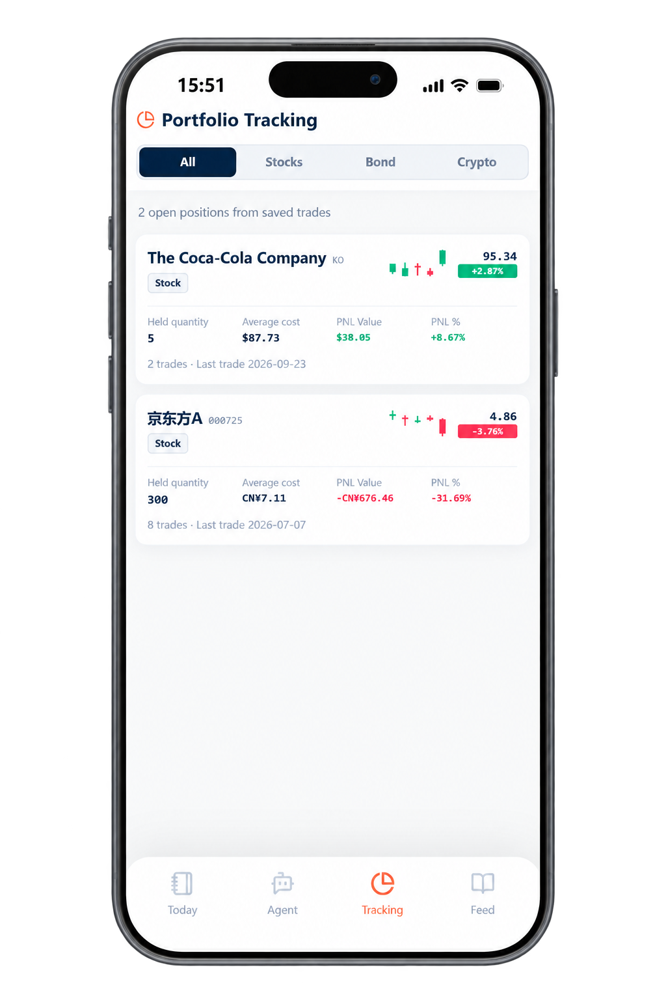</td>
    <td align="center" width="33%">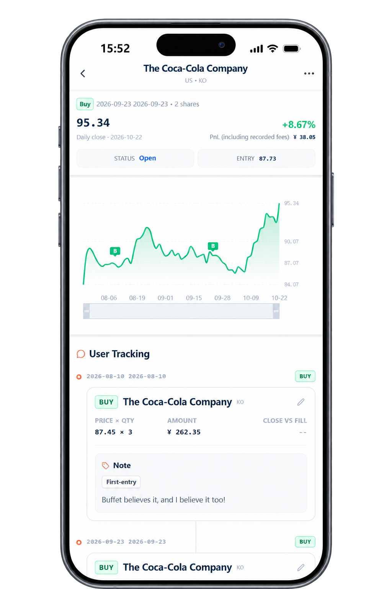</td>
    <td align="center" width="33%">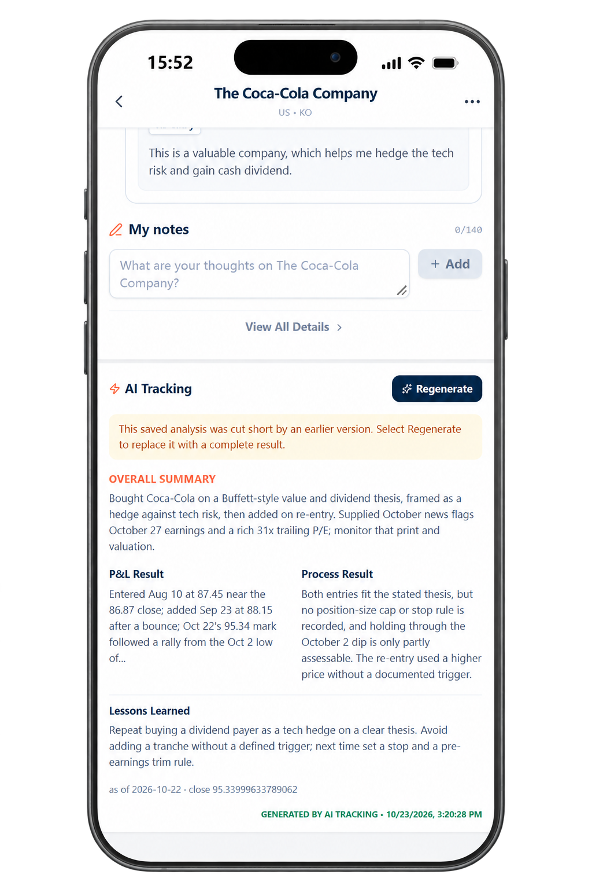</td>
  </tr>
</table>

### Feed · Learn and stay grounded

Daily reading offers investing ideas and perspective when markets feel noisy. Open an essay to explore its full argument and the book behind it.

<p align="center">
  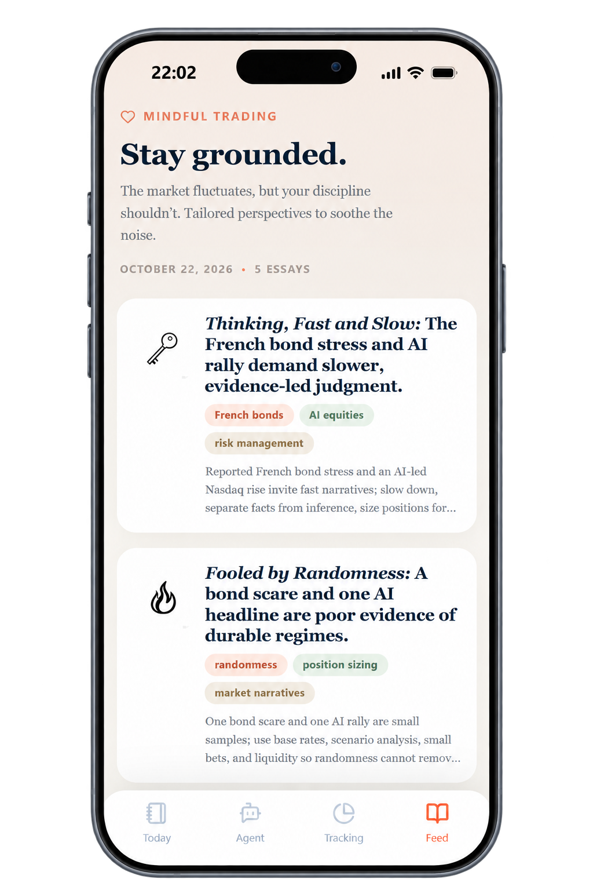
  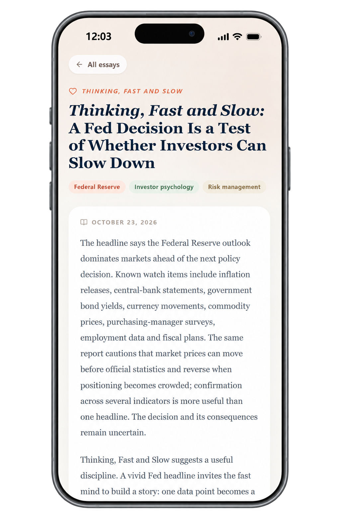
</p>

## 🏗️ Architecture and data sources

| Layer | Current production setup |
| --- | --- |
| Web app | React, TypeScript, Vite, Tailwind CSS, and PWA assets served by Nginx on Alibaba Cloud |
| API and storage | FastAPI behind the same-origin `/api` route; SQLite on the server's disk, excluded from Git |
| AI and search | DeepSeek for generated analysis; Tavily for relevant search and news when configured |
| Daily market history | A-shares: Wind → BaoStock; US stocks: Yahoo Finance → Wind; Hong Kong stocks: Yahoo Finance only |

Market data can be delayed or unavailable, and historical backtests do not predict future returns. See [developer notes](DEVELOPMENT.md) for the API, local setup, and operational details.

## 🚀 Run locally

The public URL above is the evaluation entry point. To run a separate development copy, start both the API and the frontend; the repository does not include the public server's database or credentials.

### 1. Start the API

Create a Python virtual environment in `backend/`, install the dependencies, and copy the configuration template.

<details>
<summary>Windows PowerShell</summary>

```powershell
cd backend
python -m venv .venv
.\.venv\Scripts\python.exe -m pip install -r requirements.txt
Copy-Item .env.example .env
# Set DEEPSEEK_API_KEY in .env for AI-generated features.
.\.venv\Scripts\python.exe -m uvicorn app.main:app --reload --host 127.0.0.1 --port 8000
```

</details>

<details>
<summary>macOS / Linux</summary>

```sh
cd backend
python3 -m venv .venv
./.venv/bin/python -m pip install -r requirements.txt
cp .env.example .env
# Set DEEPSEEK_API_KEY in .env for AI-generated features.
./.venv/bin/python -m uvicorn app.main:app --reload --host 127.0.0.1 --port 8000
```

</details>

Edit `backend/.env` before starting the API. Keep keys in this backend file, never in frontend variables or commits. Local API documentation is at `http://127.0.0.1:8000/docs`.

### 2. Start the frontend

You need Node.js and npm. In another terminal, from the repository root:

```sh
git clone https://github.com/Zia-Zeng/TradingNote.git
cd TradingNote
npm ci
npm run dev
```

Open the local URL printed by Vite, usually `http://127.0.0.1:5173/`. The local frontend defaults to `http://127.0.0.1:8000`; `VITE_API_BASE_URL` is a **build-time** setting when the API is hosted elsewhere. The Alibaba Cloud build uses `/` so its API calls remain on the public site's origin. Some backtests require additional market-data access or the SuperMind runner; see [developer notes](DEVELOPMENT.md).

## 🗂️ File navigation

```text
.
├── src/                  React pages, components, and frontend helpers
│   ├── pages/            Today, Agent, Tracking, Feed, and detail screens
│   ├── components/       Reusable interface components
│   └── lib/              API client, imports, and journal helpers
├── backend/
│   ├── app/              FastAPI routes, storage, AI, and market data
│   ├── strategies/       Backtest strategy implementations
│   └── tests/            Backend checks
├── public/               PWA manifest and app icons
├── assets/readme/         Logo and product screenshots used here
├── DEVELOPMENT.md        Detailed API and feature notes
├── README.md             English guide
└── README.zh-CN.md       简体中文指南
```

## 🛠️ Built with

React, TypeScript, Vite, and Tailwind CSS on the frontend; Python, FastAPI, and SQLite on the backend. Nginx serves the public frontend and proxies `/api` on the Alibaba Cloud server. AI and market-data integrations are configured through the backend environment.

## 🤝 Contributing

Feedback, bug reports, and focused pull requests are welcome. Include the steps to reproduce a problem and keep credentials and personal trading data out of commits.

> TradingNote is for journaling, learning, and historical simulation. Backtest results do not predict future performance, and the app does not connect to a brokerage or place trades.
